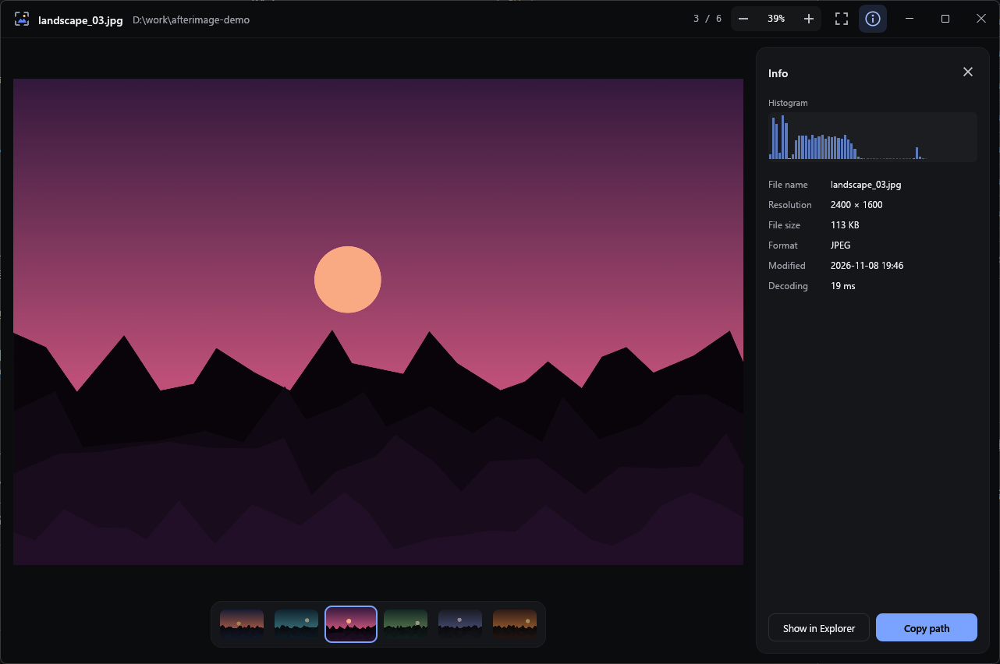

# Afterimage

빠르게 열리고, 넘길 때 끊기지 않는 Windows용 이미지 뷰어예요.

[English](README.md)



## 다운로드

[최신 릴리스](https://github.com/Hoyeom/afterimage/releases/latest)에서 `afterimage.exe`를 받아 바로 실행하면 돼요. 설치는 필요 없어요.

코드 서명이 없어서 처음 실행할 때 Windows 경고가 뜰 수 있어요.

## 특징

- **빠른 넘기기:** 앞뒤 이미지를 백그라운드 스레드에서 미리 디코딩해요.
- **탐색기와 같은 순서:** 그 폴더를 연 탐색기 창이 있으면 창의 정렬 순서를 따르고, 없으면 탐색기와 같은 방식의 이름순으로 보여 줘요.
- **순환 넘기기:** 마지막 이미지에서 다음으로 가면 첫 이미지로 돌아가요. 반대도 마찬가지예요.
- **애니메이션:** GIF, WebP, APNG를 재생해요.
- **정보 패널:** 히스토그램과 EXIF 정보를 볼 수 있어요.
- **시스템 언어:** Windows 표시 언어를 따라가요. 한국어와 영어를 지원하고, 그 밖의 언어는 영어로 나와요.

## 사용법

`afterimage.exe <이미지 파일>`로 실행하거나, 이미지를 창으로 끌어다 놓거나, Ctrl+O를 누르세요.

| 키 | 동작 |
| --- | --- |
| ← / →, PageUp / PageDown, Space / Backspace | 이전 / 다음 |
| Home / End | 처음 / 마지막 |
| 마우스 휠, Ctrl+휠, 핀치 | 커서 위치 기준 줌 |
| + / − | 확대 / 축소 |
| 0 | 화면에 맞춤 |
| 1 | 실제 크기 (100%) |
| 더블클릭 | 맞춤 ↔ 100% |
| 드래그 | 확대 상태에서는 이동, 맞춤 상태에서는 좌우로 밀어 넘기기 |
| I | 정보 패널 |
| P | 애니메이션 일시정지 / 재생 |
| F / F11 | 전체 화면 |
| Ctrl+O | 파일 열기 |
| Esc | 전체 화면 해제 → 패널 닫기 → 종료 |

## 지원 형식

- JPEG, PNG, GIF, WebP, BMP, TIFF, ICO
- GIF, WebP, APNG 애니메이션 (디코딩한 프레임 기준 약 384MB까지)
- HEIC, HEIF, AVIF는 Windows 내장 코덱으로 열어요. 아래 Microsoft Store 확장이 필요해요.
  - HEIC / HEIF: HEIF 이미지 확장, HEVC 비디오 확장
  - AVIF: AV1 비디오 확장

RAW는 아직 지원하지 않아요.

## 자동 업데이트

앱을 켤 때마다 백그라운드에서 GitHub Releases의 새 버전을 확인해요. 새 버전이 있으면 릴리스 서명을 확인하고, 새 실행 파일을 받아 서명된 SHA-256 값과 비교한 뒤 교체해요. 다음에 켤 때 적용돼요.

이때 github.com에 접속하지만 이미지나 개인 정보는 보내지 않아요. 업데이트는 GitHub 밖에 보관한 키로 서명하기 때문에, GitHub 계정만 뚫려서는 업데이트를 위조할 수 없어요. 실행 파일 자체에는 코드 서명 인증서가 없어요.

끄려면 환경 변수 `AFTERIMAGE_NO_UPDATE=1`을 설정하세요. `Program Files`처럼 쓰기 권한이 없는 폴더에서는 새 버전이 있다고 알려 주기만 해요.

## 직접 빌드

[rustup.rs](https://rustup.rs)에서 Rust를 설치한 뒤 실행하세요.

```
cargo run --release -- "D:\사진\example.jpg"
```

결과물은 `target\release\afterimage.exe`예요. `target` 폴더에서 실행한 빌드는 자동 업데이트를 건너뛰어요.

## 라이선스

[MIT](LICENSE)
