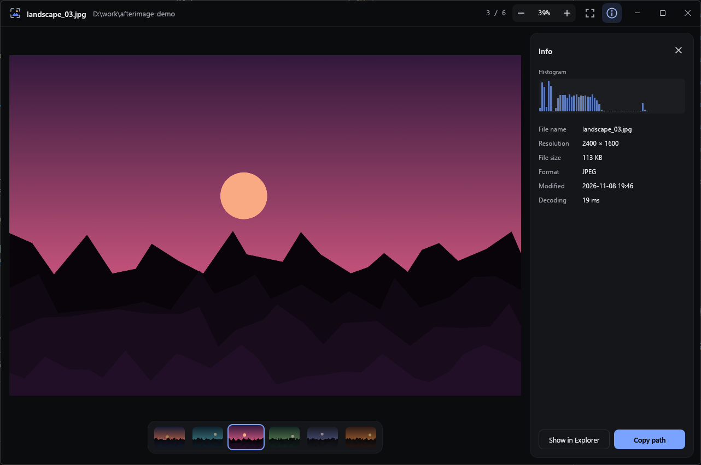

# Afterimage

A fast image viewer for Windows. It opens quickly and doesn't stutter when you flip through a folder.

[한국어](README.ko.md)



## Download

Get `afterimage.exe` from the [latest release](https://github.com/Hoyeom/afterimage/releases/latest) and run it. There's no installer.

The exe isn't code-signed, so Windows may show a warning the first time you run it.

## Features

- **Fast flipping:** neighbouring images are decoded ahead of time on background threads.
- **Same order as Explorer:** if an Explorer window has the folder open, Afterimage follows its sort order. Otherwise it sorts by name the way Explorer does.
- **Loops around:** next and previous wrap between the last and first image.
- **Animations:** plays GIF, WebP and APNG.
- **Details on demand:** info panel with a histogram and EXIF data.
- **Your language:** follows the Windows display language. Korean and English are available, and other languages fall back to English.

## Usage

Run `afterimage.exe <image file>`, drop an image onto the window, or press Ctrl+O.

| Key | Action |
| --- | --- |
| ← / →, PageUp / PageDown, Space / Backspace | Previous / next |
| Home / End | First / last |
| Mouse wheel, Ctrl+wheel, pinch | Zoom at the cursor |
| + / − | Zoom in / out |
| 0 | Fit to window |
| 1 | Actual size (100%) |
| Double-click | Toggle fit / 100% |
| Drag | Pan when zoomed in; swipe to the next image when fitted |
| I | Info panel |
| P | Pause / play animation |
| F / F11 | Fullscreen |
| Ctrl+O | Open a file |
| Esc | Leave fullscreen → close panel → quit |

## Supported formats

- JPEG, PNG, GIF, WebP, BMP, TIFF, ICO
- Animated GIF, WebP and APNG, up to about 384 MB of decoded frames
- HEIC, HEIF and AVIF through the codecs built into Windows, which need these Microsoft Store extensions:
  - HEIC / HEIF: HEIF Image Extensions and HEVC Video Extensions
  - AVIF: AV1 Video Extension

RAW isn't supported yet.

## Automatic updates

Each time it starts, Afterimage checks GitHub Releases for a newer version in the background. If there is one, it verifies the release signature, downloads the new exe, checks its SHA-256 hash against the signed value and replaces the exe. The new version applies the next time you open the app.

This connects to github.com and sends no images or personal information. Updates are signed with a key kept off GitHub, so a compromised GitHub account alone can't push one. The exe itself has no code-signing certificate.

To turn updates off, set the environment variable `AFTERIMAGE_NO_UPDATE=1`. In folders the app can't write to, such as `Program Files`, it only tells you that a new version is available.

## Build from source

Install Rust from [rustup.rs](https://rustup.rs), then:

```
cargo run --release -- "D:\Photos\example.jpg"
```

The result is `target\release\afterimage.exe`. Builds run from a `target` folder skip automatic updates.

## License

[MIT](LICENSE)
